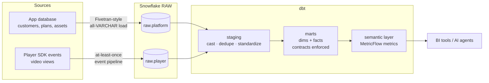
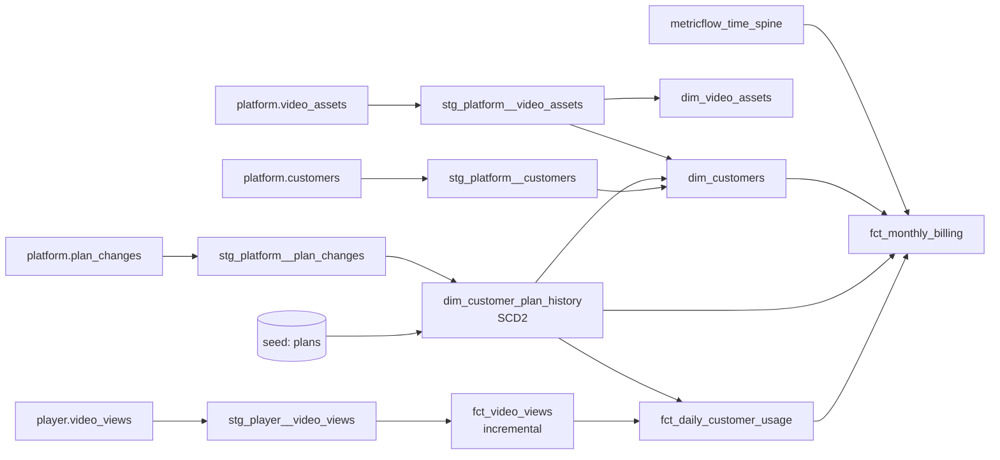

# Video Platform Analytics: dbt + Snowflake

[](https://github.com/zenobiapanvelwallavideo-analytics-dbt/actions/workflows/ci.yml)

An end-to-end analytics stack for **Framewise**, a fictional video API company.
Customers upload videos, their viewers watch them, and Framewise bills each
customer by **minutes delivered**. The stack answers two kinds of questions:

- **Playback quality (QoE):** Which CDN had a spike in playback failures last month? Is startup time worse on mobile?
- **Revenue:** How much revenue came from overage? What plan was a customer on when they used the product?

The data is synthetic but deliberately messy (duplicate events, late arrivals,
inconsistent codes), and it includes a hidden CDN incident for the models and
metrics to surface.

## Architecture



### Lineage



## Data model

| Model | Grain | Notes |
|---|---|---|
| `dim_customers` | one row per customer | current plan, plan-change counts |
| `dim_customer_plan_history` | one row per customer per plan period | **SCD Type 2** built from a change log; `[valid_from, valid_to)` |
| `dim_video_assets` | one row per video asset | |
| `fct_video_views` | one row per playback session | **incremental** with a lookback window for late events; clustered by `view_date` on Snowflake |
| `fct_daily_customer_usage` | one row per customer per day | point-in-time join to the plan in effect that day |
| `fct_monthly_billing` | one row per customer per month | base fee + overage; includes zero-usage months |

## What this project demonstrates

**Modeling**
- Staging → marts layering, with all cleaning done once, in staging
- Dimensional modeling with explicit, documented grain on every fact
- SCD Type 2 built from an append-only change log, plus point-in-time joins against it
- Incremental fact table with `merge` (Snowflake) and a configurable lookback for late-arriving data

**Data quality**
- **67 tests run on every build (65 data tests + 2 unit tests):** uniqueness, not-null, relationships, and accepted values, plus custom generic tests
- **Custom generic tests** (in `macros/tests/`): `no_overlapping_ranges` for SCD2 integrity, `unique_combination_of_columns` for grain, `value_between`, `is_non_negative`
- **Unit tests** (dbt 1.8+) for the SCD2 logic and the billing math, run against fixed fixture data
- **Reconciliation tests:** billed minutes equal usage minutes, and no views are lost between staging and the fact table
- **Model contracts** on all marts, so column names and types can't change silently under downstream consumers
- **Source freshness** SLAs per source

**Semantic layer**
- MetricFlow semantic models and 17 metrics (failure rate, rebuffer percentage, p50/p95 startup time, revenue, overage share, ARPC). Each metric is defined once and queryable by any tool or agent.

**Platform / Snowflake administration** (`snowflake/`)
- Role-based access: `LOADER` → `TRANSFORMER` → `REPORTER`, with separate RAW and ANALYTICS databases
- Separate XS warehouses per workload, 60-second auto-suspend, a resource monitor, and a statement timeout
- Every dbt query is tagged with its model name (`macros/set_query_tag.sql`), so spend can be attributed per model (`snowflake/cost_monitoring.sql`)
- Dev builds only the last 30 days of data (`limit_data_in_dev`) to keep dev runs cheap
- Environment-aware schema naming: clean names in prod, prefixed per developer in dev

**CI/CD** (`.github/workflows/ci.yml`)
- Every PR generates data, runs the full build and all tests, re-runs the incremental model to check idempotency, and validates the semantic layer. It uses DuckDB, so no secrets are needed.
- A Snowflake Slim CI job (`state:modified+ --defer`) is included, ready to enable.

## Example: finding the CDN incident through the semantic layer

```bash
$ mf query --metrics total_views,playback_failure_rate,median_startup_time_ms,p95_startup_time_ms \
           --group-by view__cdn

view__cdn   total_views   median_startup_time_ms   p95_startup_time_ms   playback_failure_rate
cdn_b             69378                      954               2423.15                0.0135
cdn_c             29528                     1190               3036                   0.0132
cdn_a             99169                      947               2437                   0.0139
```

`cdn_c` has noticeably slower startup. Drilling into daily failure rate for `cdn_b`
surfaces the incident:

```bash
$ mf query --metrics playback_failure_rate --group-by metric_time__day,view__cdn \
           --where "{{ Dimension('view__cdn') }} = 'cdn_b'" --order -playback_failure_rate --limit 3

metric_time__day      view__cdn   playback_failure_rate
2026-10-14            cdn_b                     0.0623    <- ~4.5x the normal rate
2026-05-28            cdn_b                     0.0421
2026-10-13            cdn_b                     0.0414
```

(Exact numbers vary, because the data is generated relative to today's date.)

## Running it

### Locally (DuckDB, about 1 minute, no accounts needed)

```bash
python -m venv .venv && source .venv/bin/activate
make setup      # pip install -r requirements.txt
make data       # generate ~200k views and load them into DuckDB
make build      # dbt build: seeds, models, all tests
make metrics    # validate the semantic layer and run a sample query
make docs       # browse the docs site and lineage graph
```

### On Snowflake

1. Run `snowflake/setup.sql` as ACCOUNTADMIN (a free trial account works).
2. Set environment variables: `SNOWFLAKE_ACCOUNT`, `SNOWFLAKE_USER`, `SNOWFLAKE_PASSWORD`.
3. Load and build:

```bash
pip install -r requirements-snowflake.txt
python scripts/generate_data.py --out data
python scripts/load_raw.py --target snowflake
DBT_TARGET=snowflake_dev dbt build
```

## Design decisions

- **Raw lands as VARCHAR.** This mirrors managed ingestion tools. Type casting is owned by staging, so a malformed value fails a test instead of failing the load.
- **Deduplication in staging, not in the fact.** Every downstream model can assume one row per `view_id`.
- **Plan attribution = plan in effect at end of day / end of month.** This is a deliberate simplification instead of proration. It is documented on the model and asserted by unit tests.
- **The semantic layer replaces aggregate tables.** There's no `agg_daily_qoe_by_cdn` table. Those questions go through metrics instead, so there are fewer models to maintain and one definition per metric.
- **Contracts only on marts.** Staging stays flexible; the public interface is locked.

## Next steps

- Data observability with Elementary (anomaly detection on row counts and freshness)
- Reverse ETL: push `fct_monthly_billing` to a CRM so account teams can see usage and overage
- An MCP server over the semantic layer, so an LLM agent can answer metric questions, plus an eval set of question/answer pairs to check agent accuracy
- SQLFluff linting in CI

## Project structure

```
├── .github/workflows/ci.yml        CI: build, test, idempotency, semantic validation
├── analyses/                       Queries to run checks and analyses on the data
├── scripts/
│   ├── generate_data.py            synthetic data with realistic mess + an incident
│   └── load_raw.py                 loads CSVs to DuckDB or Snowflake (all VARCHAR)
├── snowflake/
│   ├── setup.sql                   roles, warehouses, databases, resource monitor
│   └── cost_monitoring.sql         spend by warehouse and by dbt model
├── seeds/plans.csv                 plan pricing reference
├── macros/
│   ├── tests/                      custom generic tests
│   ├── generate_schema_name.sql    env-aware schemas
│   ├── limit_data_in_dev.sql       cheap dev builds
│   └── set_query_tag.sql           per-model cost attribution
├── models/
│   ├── staging/                    sources, casting, dedupe, standardization
│   ├── marts/core/                 dims, SCD2, incremental fact
│   ├── marts/finance/              daily usage, monthly billing
│   ├── utilities/                  time spine
│   └── semantic/                   MetricFlow semantic models + metrics
└── tests/                          singular reconciliation tests
```
